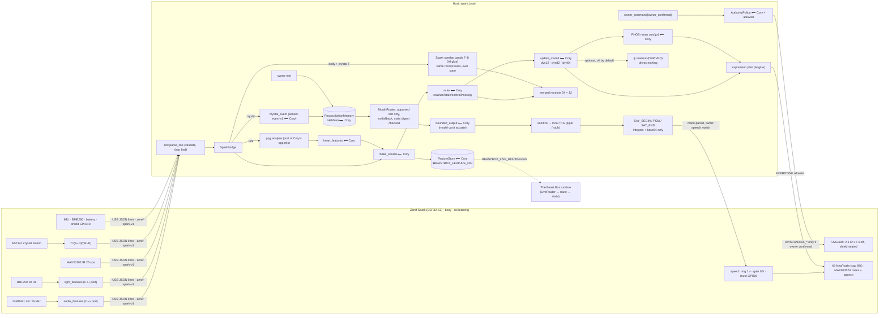

# Zeref Spark brain architecture

> **CONCEPT DESIGN / NOT BUILT HARDWARE.** The host code runs and is tested on recorded and simulated frames only.
> The pulse is an **ESTIMATE, non-medical**. **SIMULATION ≠ real measurement.**

Rule from Cory's work: **MODEL ≠ MEMORY ≠ STATE ≠ AUTHORITY.** Models are mouths. They talk. They don't hold the
memory, own the state, or control the hardware.

## Who wrote what

| Piece | File | Label |
|---|---|---|
| Routing, dyn12/42/54, feature extractors, make_source, FeatureStore, memory, events, providers, box | `host/spark_brain/beastbox_vendor/*` (byte-identical, SHA256SUMS checked by a test) | **Cory original** |
| Firmware base: pins, mic, CAL_AUDIO, JSON lines, legacy probe packet | `firmware/reality_bridge_probe_v0.2_original/` (untouched) | **Cory original** |
| PPG analyser | `host/spark_brain/ppg.py` (port of `apps/beastbox-cloud/lib/bio/ppg.mjs`) | **Cory original (ported by AI)** |
| C++ ports of audio/light features | `firmware/zeref_spark_fw/include/spark_features.h` | **Cory original (ported by AI)**, parity-tested |
| PHOS readout | `bridge.phos` (re-typed from `cns.py:78`) | **Cory original** |
| Mouth router rules | `mouths.py` (rules from `model_router.py`) | **Cory rules, AI code** |
| Libraries: Arduino-ESP32, ArduinoJson, Adafruit NeoPixel/AS7341, SparkFun MAX3010x, BH1750, BME280, finani ICM42688, TinyGPSPlus, pyserial | platformio.ini / pip | **Third-party** |
| IR DC ≥ 50 000 finger test | `ppg.py` | **Third-party heuristic (SparkFun examples)** |
| Overlay bands, ψ mapping, speech path, link validation, bridge, expression plan, crystal events, UV guard, firmware frames, CLI, tests | the rest | **AI glue** |
| ψ formula | `psi.py` (form from 12D-Hebbian-Transformer-ver.4.20 README.md:78) | **Cory original form, AI mapping** |
| Local TTS (piper + lessac voice) | `speech.py`, `~/.zeref-spark/ttsv` | **Third-party** |

Each output carries `provenance.py` labels, so you can always see where a number came from.

## What happens on one second of real data

1. The Spark sends one `features/audio` frame, one `features/light` frame, 25 IR samples and one `body` frame.
2. The bridge checks each frame. Audio and light become `make_source(site="on-device")`. The IR samples go into a
   30 s window. Once the window passes Cory's quality gate, the beat intervals become
   `heart_features` → `make_source(site="on-box")`.
3. `route()` sorts all 54 slots. On the synthetic demo: 29 `real` (12D audio/light/heart plus bands 1–3) and 25
   `missing` (quantum, EEG, game, world). `update_routed()` steps the state, and the receipts store hashes only.
4. The expression plan maps the state to colours. The eyes go dim grey when nothing real is driving the state.
   Only allowlisted `EXPR`/`TONE` commands go back to the Spark.
5. Body and crystal features go to the Spark overlay bands (66 receipts in total); Cory's 54-slot state is unchanged by them.
6. Talking writes to Hebbian memory. A model only speaks through a slot you approved. If that slot is down, the
   answer is "denied", not a quiet switch to another model. With speech on, the approved reply is the only text that
   reaches the TTS, and only audio samples reach the device.
