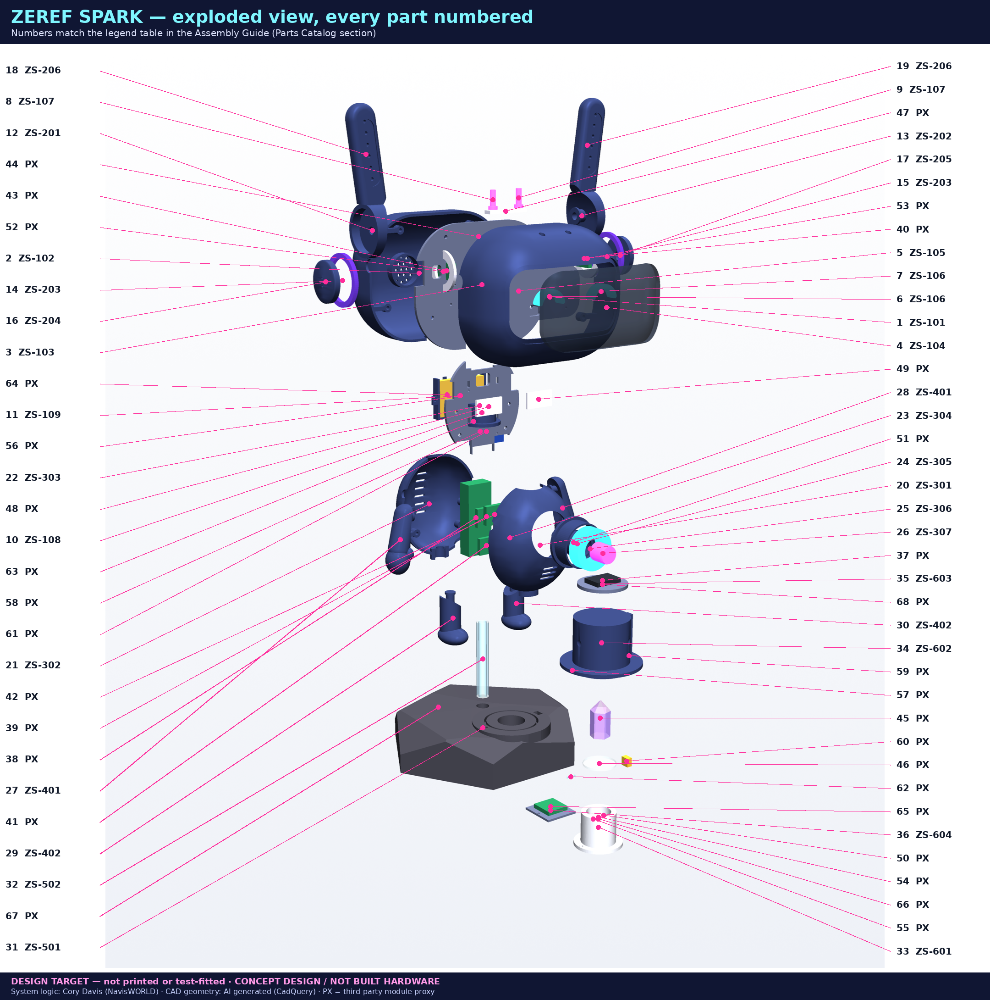

<h1 class="nobreak">ZEREF SPARK — Teacher's Guide</h1>

**Build-and-learn unit: CAD, 3D printing, embedded sensors, spectroscopy and honest data**

DESIGN TARGET — not printed or test-fitted CONCEPT DESIGN / NOT BUILT HARDWARE

**System logic and concept: Cory Davis (NavisWORLD).** CAD geometry, renders and this guide: **AI-generated** from that logic. **PX** parts are third-party modules (Espressif, TDK, Bosch, ROHM, ADI, ams-OSRAM, Adafruit, u-blox …) shown as proxies.
Use with the *ZEREF SPARK Assembly Guide* (same folder). Nothing here has been classroom-tested yet — time estimates are ESTIMATES.

# 1. Unit overview and learning objectives

Students build (or study, if hardware is not available) a 314 mm companion robot whose **brain runs on a host computer** (the Beast Box) while the robot is the **nervous system**: sensors, lights, speaker and a crystal-reading station that report data over USB / Wi-Fi.

By the end, students can:

1. **CAD** — read a parametric model, explain why parameters (not hand-drawn shapes) make a design editable, and change one parameter safely.
2. **3D printing** — choose orientation, supports, walls and infill for strength and finish, and justify the choice.
3. **Electronics** — read a schematic with designators (R1, C1, Q1…), explain pull-ups, decoupling, current-limit resistors, MOSFET switches, voltage dividers, fuses and ESD protection, and calculate R = (V − Vf)/I.
4. **Buses** — explain I2C (addresses, two wires, pull-ups) and I2S (digital audio clocks), and why the station gets its own I2C bus.
5. **Power** — build a power budget (typical vs peak), explain why the 1 A boost is "marginal", and reason about LiPo safety.
6. **Spectroscopy basics** — describe how an 11-channel sensor measures light in bands, and compute transmission T = (S − D)/(W − D).
7. **Honest data** — label every number MEASURED, DERIVED or ESTIMATE, and explain why a classification is never a measurement.
8. **Architecture** — explain "brain on the host, models are mouths": the robot does not think; the host interprets data, and AI language models only *voice* results.

# 2. Suitability, supervision and prerequisites

| Audience | Fit | How |
|---|---|---|
| Grades 6–8 (age 11–14) | Concepts + CAD/printing + pre-wired modules | Teacher pre-solders; students do CAD, printing, plug-in JST/STEMMA wiring, data labelling. **No LiPo or UV handling by students.** |
| Grades 9–12 (age 14–18) | Full unit | Students solder passives under supervision; adult does LiPo install and UV station first power-up |
| Post-secondary / makerspace | Full unit + extensions | Firmware additions, calibration study, power measurements |

**Adult supervision is REQUIRED** for: LiPo battery handling, charging and installation · any 365 nm UV LED operation · soldering · heat-set inserts (hot brass) · first power-on of each stage. Keep the UV station out of reach of young children; never let anyone look at the UV LED.

Prerequisites: basic algebra (Ohm's law), using a multimeter (can be taught in Session 4), any prior block or text coding helps for Session 9.

# 3. Lesson sequence (ESTIMATE times)

| # | Session | Time | Students do | Uses |
|---|---|---|---|---|
| 1 | The system: brain on the host, robot as nervous system | 50 min | map the data path sensor → ESP32 → USB/Wi-Fi → host → voice; discuss "models are mouths" | wiring.md diagram |
| 2 | CAD: parameters and parts | 2 × 50 min | open `cad/zs_parts.py`, read parameter dict P, predict and check what changing one value does; read part cards | parts catalog |
| 3 | 3D printing plan | 50 min + print time (≈30–45 h total, ESTIMATE) | choose orientation/supports for 3 parts and justify; print test joints | print plan |
| 4 | Electricity toolkit: meter, Ohm's law, power | 50 min | measure resistors, compute LED resistors R20–R22 | Electrical Specs |
| 5 | Reading schematics | 50 min | trace a net across sheets A–E; find every designator in the BOM | schematics |
| 6 | Buses: I2C and I2S | 50 min | address map, pull-up rise-time calc, why bus 1 for the station | Sheets B, C, E |
| 7 | Power and safety | 50 min | build the power budget; LiPo safety demo (teacher) | power tables |
| 8–10 | Build sessions (steps 1–16) | 3–5 × 50 min | assemble in teams, pass each CHECK before moving on | Assembly Guide |
| 11 | Firmware and bring-up | 2 × 50 min | flash Stage 0, run tests, read JSON | §10 |
| 12 | Spectroscopy lab | 2 × 50 min | calibrate (dark/white), measure 3 samples, compute T, label data | §11 |
| 13 | Honest-data review + presentations | 50 min | present results with MEASURED / DERIVED / ESTIMATE labels | rubric |

Total ≈ 18–22 class periods (ESTIMATE). A no-hardware version (Sessions 1, 2, 4–7, 13 + simulated data) takes ≈ 9 periods.

# 4. Key concepts (teacher notes)

## CAD (parametric design)
The robot is code: CadQuery scripts build each solid from named parameters (e.g. pedestal radius `ped_R = 95`). Change a parameter, rebuild, and every dependent part updates. A *fit check* then tests every pair of parts for overlap. Point out the honesty label: **DESIGN TARGET — not printed or test-fitted** — a model is a plan, not proof.

## 3D printing
Layer lines are weakest across layers, so pegs print upright and shells print split-face down. Walls carry strength more than infill. Heat-set inserts give durable threads in plastic. Light-tight parts (the shield) need opaque filament and 100 % top layers.

## I2C and I2S
- **I2C**: two wires (SDA data, SCL clock) shared by many devices, each with a 7-bit **address** (BH1750 0x23, MAX30102 0x57, IMU 0x68, BME280 0x76; AS7341 0x39). Lines are open-drain, so **pull-up resistors** (R3/R4, R9/R10) pull them high; too-weak pull-ups make slow edges (rise time ≈ 0.847·R·C).
- **I2S**: a digital-audio bus with a bit clock (BCLK), a word-select/left-right clock (WS/LRC) and data. The mic uses I2S0; the amplifier uses I2S1.
- The station's sensor is on a **second I2C bus** because its cable plugs/unplugs (pogo) and is longer — a fault there can't freeze the main sensors.

## Sensors
IMU (motion), BME280 (temperature/humidity/pressure), BH1750 (light, lux), MAX30102 (pulse-oximetry optics), INMP441 (sound), GNSS (position), AS7341 (colour spectrum). Each produces **raw readings** — the starting point of honesty.

## Spectroscopy basics
White light is a mix of wavelengths. The AS7341 has 8 visible channels (≈415–680 nm), Clear, and NIR (≈910 nm). Shine light **through** a crystal (transmission) and compare with a white reference: `T = (S − D)/(W − D)` where S = sample, D = dark, W = white (PTFE). Under 365 nm UV some materials **fluoresce** (re-emit longer wavelengths); a UV-cut filter blocks the UV so only that glow is measured.

## Power
USB-C supplies 5 V. The PowerBoost charges the LiPo and boosts 3.7 V → 5.2 V (≈1 A max). The power budget shows ≈0.30 A typical and ≈0.97 A peak — **tight**, so firmware caps LED brightness at 8 % (decided 2026-11-09). Fuses (F1, F2), the cell's protection circuit, TVS/ESD diodes and bulk capacitors keep it safe.

## MEASURED vs DERIVED vs ESTIMATE
| Label | Meaning | Example |
|---|---|---|
| MEASURED | read directly from a sensor or meter | AS7341 raw counts, battery volts on a meter |
| DERIVED | calculated from measurements | T ratios, VBAT = 2 × Vadc |
| ESTIMATE | a model, guess, or classification with uncertainty | "closest match: amethyst (62 %)", CAD dimensions, power budget |

No metaphysical or energy claims are made about crystals — the station measures *light*.

## Architecture: "brain on the host, models are mouths"
The ESP32 streams JSON; the Beast Box host stores, compares and decides. AI language models can describe results but are not the source of truth — the data and its labels are. Ask students: *what would go wrong if the voice invented data?*

# 5. Hands-on activities

1. **Parameter hunt (CAD).** Change `ped_R` by +5 mm in a copy of `zs_lib.py`, rebuild, re-run `check.py`. Did anything collide? Record before/after.
2. **Orientation debate (printing).** Teams pick orientations for the leg, the visor and the shield; print the leg peg two ways and try to snap them (with eye protection).
3. **LED resistor lab.** Measure a real LED's Vf at 20 mA with a bench supply + resistor; recompute R20–R22. Compare to the guide's ESTIMATE.
4. **I2C address map.** Run an I2C scanner on the Stage 1 harness; draw the bus and label each address. Add a second BME280 — what happens and how would you fix it?
5. **Pull-up scope / meter lab (advanced).** Measure total pull-up resistance with breakouts connected; decide whether R3/R4 are needed (the DNP rule).
6. **Power budget audit.** Measure 5V_SYS current at idle, LEDs at 8 % (the firmware cap), and during speech audio; compare with the budget table.
7. **Divider lab.** Measure VBAT and GPIO5; verify Vadc = VBAT/2.
8. **Spectroscopy lab.** Dark → white → 3 samples (clear glass, coloured acrylic, a crystal). Compute T per channel; plot T vs wavelength; repeat 3× for repeatability.
9. **Honest labelling.** Students label a mixed list of 15 numbers from the project as MEASURED/DERIVED/ESTIMATE and defend their choices.
10. **Safety walkthrough.** Students write the interlock logic: when can the UV LED light? Trace S1, R23/R24 and the firmware conditions.

# 6. Discussion questions

1. Why does the robot's "brain" live on the host instead of on the ESP32? What are the trade-offs?
2. What does "models are mouths" mean, and how does it protect against made-up answers?
3. Why is the CAD labelled DESIGN TARGET — not printed or test-fitted? When could that label be removed?
4. Why do I2C lines need pull-up resistors but I2S lines do not?
5. Why give the crystal station its own I2C bus?
6. Why is the UV interlock done in hardware (reed switch in series) *and* in firmware?
7. The power budget says peak ≈0.97 A on a ≈1 A boost, even with LEDs capped at 8 %. What are three ways to get more margin?
8. If the station says "looks like amethyst", is that MEASURED? What would make you trust it more?
9. What is the difference between a crystal "absorbing" light and "fluorescing"?
10. Who designed what in this project, and why does crediting matter (Cory's logic vs AI-generated CAD vs third-party modules)?

# 7. Assessment rubric

| Criterion | 4 — Exceeds | 3 — Meets | 2 — Approaching | 1 — Beginning |
|---|---|---|---|---|
| CAD understanding | modifies a parameter, predicts and verifies effects, explains fit check | explains parameters and reads part cards | identifies parts and materials | names parts only |
| Printing decisions | justifies orientation with layer-strength reasoning and tests it | picks reasonable settings | follows the plan | needs full guidance |
| Circuit calculations | correct R, P, divider and rise-time math with units and margins | correct R = (V − Vf)/I and divider | partial calculations | cannot set up the equation |
| Schematic reading | traces any net across sheets and matches designators to the BOM | traces nets in one sheet | finds components | cannot read symbols |
| Build quality and checks | passes every CHECK first time; neat, labelled harness | passes checks with minor rework | skips some checks | unsafe or incomplete |
| Data honesty | every value labelled correctly with reasons and uncertainty | labels MEASURED/DERIVED/ESTIMATE correctly | some mislabels | no labels / overclaims |
| Safety practice | anticipates hazards, helps others | follows all rules | needs reminders | unsafe behaviour (stop work) |
| Communication | clear presentation with data, credits and limits | clear presentation | incomplete | missing |

# 8. Safety and supervision checklist (teacher signs each)

| ✔ | Item |
|---|---|
| ☐ | Fire-safe area; LiPo-safe bag and sand/metal tin available; no unattended charging |
| ☐ | Battery is a **protected** cell, polarity checked, 3.6–4.2 V before install (adult) |
| ☐ | Fume extraction for soldering; eye protection for clipping and snapping tests |
| ☐ | Heat-set iron in a stand; students briefed that brass stays hot > 1 min |
| ☐ | UV glasses (UV400) available; UV LED only with shield seated; interlock tested (shield off → UV_5V = 0 V) before any student use |
| ☐ | 5 V / 3 A USB-C supply used (not PC ports) for powered tests |
| ☐ | 5V↔GND and 3V3↔GND resistance > 1 kΩ before every first power-on |
| ☐ | Station stored where young children cannot open the shield |
| ☐ | First-aid kit and burn procedure posted |

# 9. Differentiation

- **Support:** pre-soldered modules on STEMMA/Qwiic cables; worked examples for every calculation; partner reading of schematics; a printed "net-label" cheat sheet; skip GNSS and IR.
- **Extension:** write the missing firmware (LED, amp, battery, station) with honesty labels in the JSON; design a screw-retained shield; measure runtime and compare to the 1.9 h ESTIMATE; replace the boost with a 2 A design and redo the budget; build a spectral library with uncertainty.
- **No-hardware path:** CAD + simulated datasets + calculations + labelling; use renders and part cards instead of printed parts.
- **Language support:** glossary (designator, pull-up, decoupling, rail, net, address, transmission, fluorescence, ESTIMATE).
- **Accessibility:** colour-blind-safe labels (all callouts also carry text and numbers); seated build stations.

# 10. Answer key

**Learning-check answers**

1. **LED resistor, white:** R = (5.0 − 3.0)/0.020 = **100 Ω**, P = 0.02² × 100 = **0.04 W** → 0.125 W part OK. **UV:** (5.0 − 3.6)/0.020 = 70 Ω → nearest E12 **68 Ω** → 20.6 mA. **IR:** (5.0 − 1.3)/0.020 = 185 Ω → **180 Ω** → 20.6 mA.
2. **Battery divider:** Vadc = VBAT × 100k/(100k + 100k) = VBAT/2 → 4.2 V → **2.10 V**, 3.0 V → **1.50 V**. Current = 4.2/200 k = **21 µA**.
3. **I2C rise time:** 0.847 × 2.2 kΩ × 100 pF ≈ **186 ns** < 300 ns (fast mode) ✔.
4. **Shield sense:** 5.0 × 20k/(12k + 20k) = **3.13 V** → HIGH; shield off → 0 V.
5. **LED current cap:** 48 × 60 mA × 8 % = **0.23 A** (firmware cap 20/255 ≈ 7.8 %).
6. **Power budget peak:** 0.35 + 0.05 + 0.23 + 0.25 + 0.05 + 0.04 = **0.97 A** — just under the ≈1 A boost limit → tight (ESTIMATE).
7. **Runtime:** 1.0 Ah × 3.7 V × 0.85 / (5.2 V × 0.30 A) ≈ **2.0 h** (ESTIMATE).
8. **Transmission:** S = 2400, D = 400, W = 4400 → T = (2400 − 400)/(4400 − 400) = **0.50** (DERIVED).

**Discussion answers (key points)**

1. Host has far more compute, storage and models; the ESP32 stays simple, cheap, low-power and reliable. Trade-off: needs a link to the host.
2. Language models *voice* results but are not the source of truth; data + labels are, so invented answers can be checked and rejected.
3. Because nothing has been printed or test-fitted; remove only after a printed, assembled and measured build passes the checks.
4. I2C is open-drain (devices only pull low), so something must pull high; I2S is push-pull.
5. Hot-plug isolation (pogo) and a longer cable: a fault can't freeze the main sensor bus; it can also run slower (100 kHz).
6. Defence in depth: firmware can crash or have bugs; the reed in series physically cuts UV current when the shield is off.
7. Keep the 8 % LED cap, drop GNSS, limit speech volume (firmware gain 0.5), use a 2 A boost, or stagger loads.
8. No — it's an ESTIMATE from nearest-match. Trust rises with calibrated, repeatable measurements, labelled reference samples, confidence values and raw data shown.
9. Absorption removes some wavelengths from light passing through (lower T); fluorescence re-emits light at longer wavelengths after excitation (e.g. UV in → visible out).
10. System logic and concept: Cory Davis (NavisWORLD). CAD geometry: AI-generated. Modules: their manufacturers. Credit gives accurate responsibility and respects people's work.

**Activity 9 sample answers:** AS7341 raw counts = MEASURED · T ratios = DERIVED · CAD 314 mm height = ESTIMATE (DESIGN TARGET) · meter reading of VBAT = MEASURED · VBAT from GPIO5 ×2 = DERIVED · power budget = ESTIMATE · crystal-type label = ESTIMATE · LED Vf from datasheet = ESTIMATE until measured.
