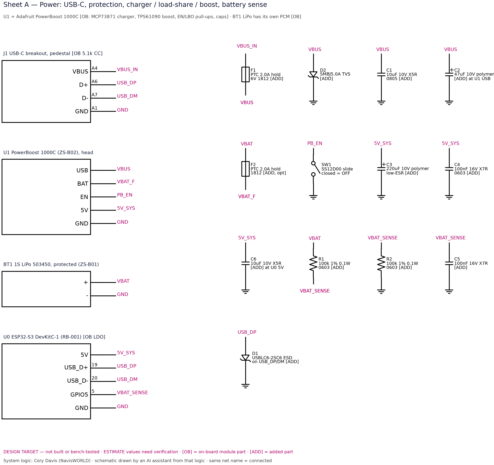
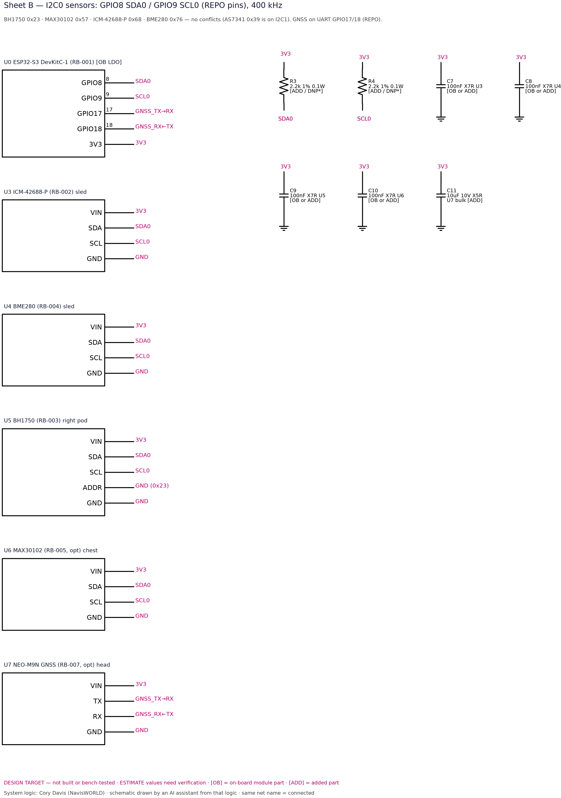
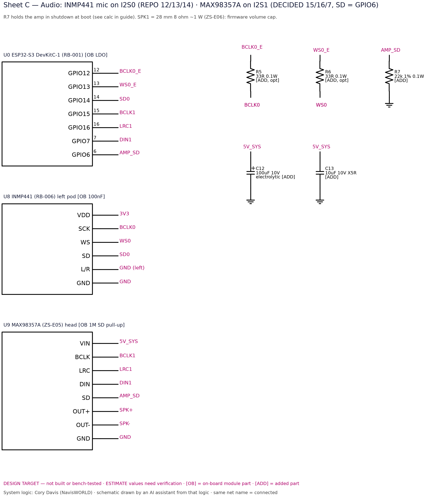
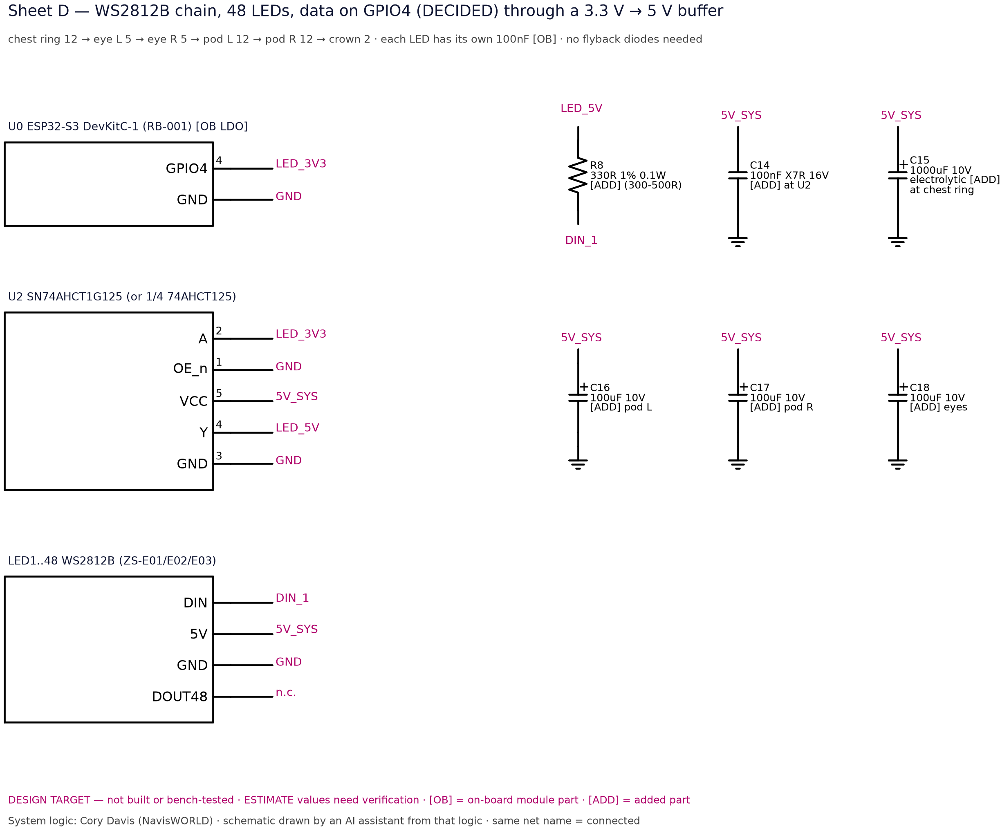
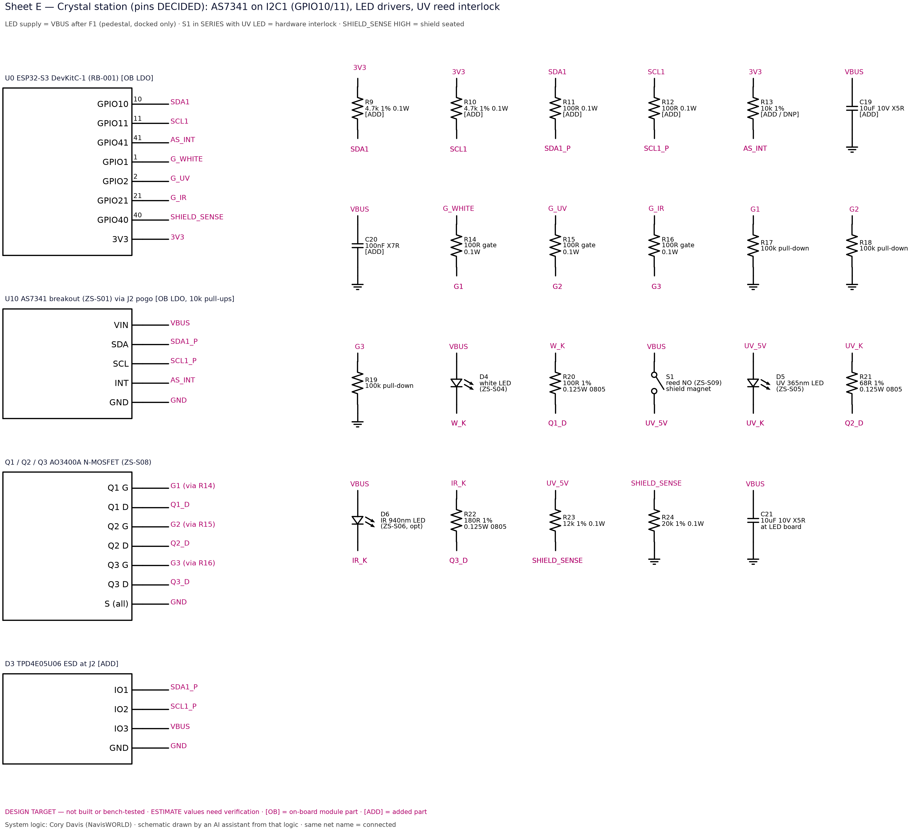

# Electrical Specifications

> **DESIGN TARGET — not built or bench-tested.** Values marked **ESTIMATE** are calculated from datasheet typicals, not measured. **[OB]** = part already on a bought module (do not add). **[ADD]** = part you add. **DNP** = do not populate unless the check says so. Designators match `docs/BOM_electrical.csv` and the schematics.

> **Changed 2026-11-09:** LED brightness cap 10 % → **8 %** everywhere (firmware 20/255), decided by Robot X under Cory's delegation (docs/DESIGN_DECISIONS.md D1). Peak 5V_SYS budget 1.03 A → 0.97 A (ESTIMATE).

## Pin map — DECIDED (Robot X under Cory's delegation, 2026-11-09)

All pins below are **DECIDED** (docs/DESIGN_DECISIONS.md D3). REPO = Cory's Reality Bridge Probe v0.2 pins, unchanged. The firmware (`firmware/zeref_spark_fw/include/spark_pins.h`, zs-0.4.0) uses exactly this table. Not yet checked on a powered board.

| Signal | GPIO | Goes to | Status |
|---|---|---|---|
| I2C0 SDA / SCL | 8 / 9 | ICM-42688-P, BME280, BH1750, MAX30102 | REPO |
| I2S0 BCLK / WS / SD | 12 / 13 / 14 | INMP441 mic | REPO |
| GNSS RX / TX | 17 / 18 | GNSS (unwired by default, `SPARK_GNSS_WIRED=0`) | REPO |
| LED data | 4 | 74AHCT125 → 48 × WS2812B (cap 8 %) | DECIDED (approved by Cory) |
| I2S1 BCLK / LRC / DIN | 15 / 16 / 7 | MAX98357A (tones + streamed speech) | DECIDED (approved by Cory) |
| Amp SD (mute) | 6 | MAX98357A SD, LOW = muted, muted at boot | DECIDED (approved by Cory) |
| Battery sense | 5 (ADC1_CH4) | 100 k / 100 k divider, VBAT = 2 × Vadc | DECIDED |
| I2C1 SDA / SCL | 10 / 11 | AS7341 (0x39) via pogo, 100 kHz | DECIDED |
| AS7341 INT | 41 | AS7341 INT, open drain | DECIDED |
| White / UV 365 / IR 940 gate | 1 / 2 / 21 | AO3400A Q1 / Q2 / Q3 | DECIDED |
| Shield sense | 40 | HIGH = shield seated (after reed S1) | DECIDED |
| USB D+ / D− | 19 / 20 | native USB CDC (host link) | DevKit |

## Voltage rails

| Rail | Range | Source | Max load | Notes |
|---|---|---|---|---|
| VBUS_IN / VBUS | 4.75–5.25 V | USB-C J1 → F1 (2 A hold) | ≈1.87 A peak (ESTIMATE) | Needs a **5 V / 3 A** USB-C supply. A PC USB2 port (0.5 A) is NOT enough. |
| VBAT | 3.0–4.2 V (3.7 V nom.) | BT1 protected LiPo | ≈1.5 A to the boost at 1 A out (ESTIMATE) | Cell PCM cuts at ≈2.5–3.0 V |
| VS (load-share) | VBUS or VBAT | MCP73871 inside U1 | — | internal to the PowerBoost |
| 5V_SYS | 5.2 V ±2% | U1 TPS61090 boost | ≈1 A | Peak budget ≈0.97 A with the 8 % LED cap — tight, see power budget |
| 3V3 | 3.3 V | DevKit on-board LDO [OB] | keep external load < 100 mA (ESTIMATE) | feeds I2C0 sensors, mic, GNSS |
| AS7341 internal | 3.3 V / 1.8 V | breakout regulators [OB] | — | fed from VBUS through the pogo |
| UV_5V | 0 V or VBUS | reed S1 (shield seated) | ≈21 mA | hardware UV interlock |

## Power budget (ESTIMATE)

**5V_SYS (boost output, ≈1 A limit)**

| Load | Typical | Peak | Basis |
|---|---|---|---|
| ESP32-S3 + Wi-Fi | 0.10 A | 0.35 A | datasheet TX burst |
| WS2812B quiescent (48 × ≈1 mA) | 0.05 A | 0.05 A |  |
| WS2812B light, 8 % brightness cap (firmware 20/255) | 0.08 A | 0.23 A | 48 × 60 mA × 8 % |
| MAX98357A + 8 Ω speaker | 0.03 A | 0.25 A | ≈1 W peaks |
| Sensors + mic (via 3V3 LDO) | 0.01 A | 0.05 A | MAX30102 LED pulses |
| GNSS (optional) | 0.03 A | 0.04 A | acquisition |
| **Total 5V_SYS** | **≈0.30 A** | **≈0.97 A** | **tight vs ≈1 A** with the 8 % LED cap (DECIDED, D1); drop GNSS if brown-outs |

**VBUS (USB-C input)**

| Load | Typical | Peak |
|---|---|---|
| MCP73871 charger + load-share (input limit) | 0.6 A | 1.8 A |
| Station LEDs (one at a time, 20 mA) | 0.00 A | 0.02 A (0.06 A if all on) |
| AS7341 breakout | <0.01 A | <0.01 A |
| **Total VBUS** | **≈0.6 A** | **≈1.87 A** |

Battery runtime (ESTIMATE): 1000 mAh × 3.7 V × 0.85 boost efficiency / (5.2 V × 0.30 A) ≈ **2.0 h typical**, ≈0.6 h at sustained peak.

## Resistors (every one)

| Ref | Sheet | Value | Pkg | Power | Tol. | OB/ADD | ESTIMATE? | Calculation / purpose |
|---|---|---|---|---|---|---|---|---|
| R1 | A | 100 kΩ | 0603 | 0.1 W | ±1% | ADD |  | divider top: VBAT → VBAT_SENSE |
| R2 | A | 100 kΩ | 0603 | 0.1 W | ±1% | ADD |  | Vadc = VBAT·R2/(R1+R2) = VBAT/2 → 1.50–2.10 V; I = 4.2/200k = 21 µA |
| R3 | B | 2.2 kΩ (DNP if breakouts' parallel pull-ups ≤ 3.3 kΩ) | 0603 | 0.1 W | ±1% | ADD / DNP |  | SDA0 pull-up; tr = 0.847·R·C = 0.847·2.2k·100pF = 186 ns ≤ 300 ns (400 kHz) |
| R4 | B | 2.2 kΩ (DNP rule as R3) | 0603 | 0.1 W | ±1% | ADD / DNP |  | SCL0 pull-up; sink current 3.3/2.2k = 1.5 mA ≤ 3 mA |
| R5 | C | 33 Ω | 0603 | 0.1 W | ±1% | ADD (optional) |  | I2S0 BCLK series damping (long pod run) |
| R6 | C | 33 Ω | 0603 | 0.1 W | ±1% | ADD (optional) |  | I2S0 WS series damping |
| R7 | C | 22 kΩ | 0603 | 0.1 W | ±1% | ADD | ESTIMATE | boot-mute pull-down: V = 5·22k/(1M+22k) = 0.108 V below 0.16 V shutdown threshold (assumes 1M [OB] pull-up — verify on your board) |
| R8 | D | 330 Ω (300–500 Ω range) | 0603 | 0.1 W | ±1% | ADD |  | damps ringing / protects first WS2812 input |
| R9 | E | 4.7 kΩ | 0603 | 0.1 W | ±1% | ADD |  | SDA1 pull-up; in parallel with [OB] 10k → 3.2k |
| R10 | E | 4.7 kΩ | 0603 | 0.1 W | ±1% | ADD |  | SCL1 pull-up |
| R11 | E | 100 Ω | 0603 | 0.1 W | ±1% | ADD |  | SDA1 series (hot-plug current limit) |
| R12 | E | 100 Ω | 0603 | 0.1 W | ±1% | ADD |  | SCL1 series |
| R13 | E | 10 kΩ (DNP if board has INT pull-up) | 0603 | 0.1 W | ±1% | ADD / DNP |  | AS_INT open-drain pull-up |
| R14 | E | 100 Ω | 0603 | 0.1 W | ±1% | ADD |  | Q1 gate series |
| R15 | E | 100 Ω | 0603 | 0.1 W | ±1% | ADD |  | Q2 gate series |
| R16 | E | 100 Ω | 0603 | 0.1 W | ±1% | ADD |  | Q3 gate series |
| R17 | E | 100 kΩ | 0603 | 0.1 W | ±1% | ADD |  | Q1 gate pull-down (LED OFF at boot / floating) |
| R18 | E | 100 kΩ | 0603 | 0.1 W | ±1% | ADD |  | Q2 gate pull-down |
| R19 | E | 100 kΩ | 0603 | 0.1 W | ±1% | ADD |  | Q3 gate pull-down |
| R20 | E | 100 Ω | 0805 | 0.125 W | ±1% | ADD | ESTIMATE | (5.0−3.0)/0.020 = 100 Ω → 20 mA; P = 0.02²·100 = 0.04 W |
| R21 | E | 68 Ω | 0805 | 0.125 W | ±1% | ADD | ESTIMATE | (5.0−3.6)/0.020 = 70 Ω → E12 68 Ω → 20.6 mA; P = 0.029 W |
| R22 | E | 180 Ω | 0805 | 0.125 W | ±1% | ADD | ESTIMATE | (5.0−1.3)/0.020 = 185 Ω → 180 Ω → 20.6 mA; P = 0.076 W |
| R23 | E | 12 kΩ | 0603 | 0.1 W | ±1% | ADD |  | SHIELD_SENSE = 5·20k/32k = 3.13 V (HIGH) when S1 closed; I = 0.16 mA |
| R24 | E | 20 kΩ | 0603 | 0.1 W | ±1% | ADD |  | pulls SHIELD_SENSE to 0 V when S1 open. If VBUS = 5.25 V → 3.28 V (≤ 3.6 V abs max OK) |

### LED current-limit resistors, worked: R = (V − Vf) / If, P = If² · R

| LED | V supply | Vf (ESTIMATE) | If target | R calc | Chosen (E12) | Actual If | P in R |
|---|---|---|---|---|---|---|---|
| D4 white | 5.0 V | 3.0 V | 20 mA | (5.0−3.0)/0.020 = 100 Ω | R20 100 Ω | 20.0 mA | 0.040 W |
| D5 UV 365 nm | 5.0 V | 3.6 V | 20 mA | (5.0−3.6)/0.020 = 70 Ω | R21 68 Ω | 20.6 mA | 0.029 W |
| D6 IR 940 nm | 5.0 V | 1.3 V | 20 mA | (5.0−1.3)/0.020 = 185 Ω | R22 180 Ω | 20.6 mA | 0.076 W |

Use 0805 0.125 W parts (≥ 1.6× margin). Check your LEDs' real Vf at 20 mA and recompute; AO3400A drop (≈0.7 mV at 20 mA) is negligible.

### Other resistor math

- **Battery sense (R1/R2 100 k / 100 k, C5 100 nF):** Vadc = VBAT × 100k / 200k → 1.50 V (3.0 V) … 2.10 V (4.2 V). Inside the ESP32-S3 ADC 11 dB range (≈0–2.9 V usable, ESTIMATE). Divider current 4.2 V / 200 kΩ = 21 µA (≈0.5 mAh/day). Firmware: VBAT = 2 × Vadc (calibrate with a multimeter once).
- **I2C0 pull-ups (R3/R4 2.2 kΩ):** rise time tr = 0.847 × R × Cbus = 0.847 × 2.2 kΩ × 100 pF ≈ 186 ns (I2C fast mode limit 300 ns). Most breakouts already carry 10 kΩ (or 4.7 kΩ) each — measure SDA→3V3 with power off: if ≤ 3.3 kΩ already, leave R3/R4 out (DNP).
- **I2C1 pull-ups (R9/R10 4.7 kΩ ∥ on-board 10 kΩ = 3.2 kΩ):** longer pogo + tube run (≈30 cm, ESTIMATE ≈150 pF): tr ≈ 0.847 × 3.2k × 150 pF ≈ 0.41 µs → run I2C1 at **100 kHz** (limit 1 µs). R11/R12 100 Ω series limit hot-plug current.
- **MOSFET gates:** R14–R16 100 Ω limit GPIO edge current into the gate; R17–R19 100 kΩ hold the LEDs OFF while the ESP32 boots (pins float).
- **Shield sense (R23 12 kΩ / R24 20 kΩ):** shield seated → S1 closed → SHIELD_SENSE = 5.0 × 20/(12+20) = 3.13 V (HIGH; 3.28 V at 5.25 V — below 3.6 V abs. max). Shield off → R24 pulls to 0 V (LOW). Current 0.16 mA.
- **Amp boot-mute (R7 22 kΩ):** with the breakout's 1 MΩ SD pull-up [OB] to VIN: V = 5 × 22k / 1.022M = 0.108 V < 0.16 V shutdown threshold → amp OFF until GPIO6 drives HIGH. ESTIMATE — verify your breakout's pull-up value.
- **NeoPixel data (R8 330 Ω):** in the 300–500 Ω range; sits at the first LED's DIN to damp ringing on the 3.3→5 V buffered line.

## Capacitors (every one)

| Ref | Sheet | Value | Type | Pkg | Voltage | Tol. | OB/ADD | Location / purpose |
|---|---|---|---|---|---|---|---|---|
| C1 | A | 10 µF | MLCC X5R | 0805 | 10 V | ±10% | ADD | Pedestal after F1 — VBUS local decoupling |
| C2 | A | 47 µF | Polymer / low-ESR electrolytic | radial 6.3 mm | 10 V | ±20% | ADD | Head, at U1 USB pad — absorbs cable inductance at charger input |
| C3 | A | 220 µF | Polymer / low-ESR electrolytic | radial 6.3 mm | 10 V | ±20% | ADD | At U1 5V out — boost output reservoir for LED + amp peaks |
| C4 | A | 100 nF | MLCC X7R | 0603 | 16 V | ±10% | ADD | At U1 5V out — HF decoupling |
| C6 | A | 10 µF | MLCC X5R | 0805 | 10 V | ±10% | ADD | At U0 5V pin — DevKit input decoupling |
| C5 | A | 100 nF | MLCC X7R | 0603 | 16 V | ±10% | ADD | At GPIO5 — ADC sample-hold reservoir; τ = 50k·100n = 5 ms |
| C7 | B | 100 nF at U3 IMU | MLCC X7R | 0603 | 16 V | ±10% | OB (usually) / ADD | U3 — add only if breakout lacks it |
| C8 | B | 100 nF at U4 BME280 | MLCC X7R | 0603 | 16 V | ±10% | OB / ADD | U4 |
| C9 | B | 100 nF at U5 BH1750 | MLCC X7R | 0603 | 16 V | ±10% | OB / ADD | U5 |
| C10 | B | 100 nF at U6 MAX30102 | MLCC X7R | 0603 | 16 V | ±10% | OB / ADD | U6 — MAX30102 LED pulses need local cap |
| C11 | B | 10 µF at U7 GNSS | MLCC X5R | 0805 | 10 V | ±10% | ADD (optional) | U7 — GNSS acquisition current bursts |
| C12 | C | 100 µF | Aluminium electrolytic | radial 5 mm | 10 V | ±20% | ADD | At U9 VIN — class-D supply reservoir |
| C13 | C | 10 µF | MLCC X5R | 0805 | 10 V | ±10% | ADD | At U9 VIN |
| C14 | D | 100 nF | MLCC X7R | 0603 | 16 V | ±10% | ADD | At U2 |
| C15 | D | 1000 µF | Aluminium electrolytic | radial 8 mm | 10 V | ±20% | ADD | Chest ring 5V/GND — LED bulk — inrush & surge protection |
| C16 | D | 100 µF | Aluminium electrolytic | radial 5 mm | 10 V | ±20% | ADD | Pod ring L |
| C17 | D | 100 µF | Aluminium electrolytic | radial 5 mm | 10 V | ±20% | ADD | Pod ring R |
| C18 | D | 100 µF | Aluminium electrolytic | radial 5 mm | 10 V | ±20% | ADD | Eye boards |
| C19 | E | 10 µF | MLCC X5R | 0805 | 10 V | ±10% | ADD | At J2 (pedestal) — pogo VIN bulk |
| C20 | E | 100 nF | MLCC X7R | 0603 | 16 V | ±10% | ADD | At J2 |
| C21 | E | 10 µF | MLCC X5R | 0805 | 10 V | ±10% | ADD | LED board — LED switching decoupling |

Rule: voltage rating ≥ 2× rail for MLCC (DC-bias derating), ≥ 1.6× for electrolytics/polymer. Watch polarity on C2, C3, C12, C15–C18.

## Diodes, fuses, switches, ICs, connectors

| Ref | Sheet | Part | Type | Pkg | Rating | OB/ADD | Note |
|---|---|---|---|---|---|---|---|
| J1 | A | USB-C 16-pin receptacle breakout (5.1k CC pull-downs on board) | Connector | breakout | 5 V / 3 A | ADD (module) | CC 5.1k = [OB]; only VBUS/GND/D+/D− used |
| D1 | A | USBLC6-2SC6 | ESD array | SOT-23-6 | 5.25 V working | ADD | on D+/D−; VBUS pin to VBUS |
| D2 | A | SMBJ5.0A | TVS diode | SMB (DO-214AA) | 5.0 V standoff, 600 W pk | ADD | clamps hot-plug spikes on VBUS |
| F1 | A | PTC resettable fuse 2.0 A hold / ~4 A trip | Polyfuse | 1812 | 6 V | ADD | VBUS peak ≈1.87 A (charger limit 1.8 A + station LEDs 60 mA) |
| U1 | A | Adafruit PowerBoost 1000C (ZS-B02) | Module | PCB 36×23 mm | in 5 V, out 5.2 V ≈1 A | ADD (module) | MCP73871 + TPS61090; on-board caps, EN & LBO pull-ups [OB] |
| BT1 | A | 1S LiPo 503450 ≈1000 mAh, with PCM (ZS-B01) | Battery | 50×34×5 mm | 3.0–4.2 V | ADD | PCM (over-charge/discharge/short) is [OB] in the cell |
| F2 | A | PTC 2.0 A hold | Polyfuse | 1812 | 6 V | ADD (optional) | backup to cell PCM |
| SW1 | A | SS12D00 SPDT slide switch | Switch | through-hole 2.54 mm | 50 V / 0.5 A | ADD | EN to GND = OFF (switch closed = OFF). Charging still works when OFF. |
| U2 | D | SN74AHCT1G125 (or 1 gate of 74AHCT125) | Logic buffer | SOT-23-5 / DIP-14 | VCC 5 V | ADD | 3.3 V → 5 V level shift (VIH = 2.0 V at 5 V) |
| LED1–48 | D | WS2812B (100 nF per LED on ring PCBs) | Smart LED | 5050 | 5 V, 60 mA max each | OB (ring modules) | 48·60 mA·8% brightness cap = 0.23 A peak (cap 10→8 % on 2026-11-09 |
| U10 | E | AS7341 breakout (ZS-S01) | Sensor module | breakout | VIN 3.3–5 V (on-board LDO) | ADD (module) | I2C 0x39 fixed; on-board 10k pull-ups and 1.8 V/3.3 V regs [OB] |
| J2 | E | 4-pin magnetic pogo pair | Connector | 2.54 mm pitch | 2 A per pin (typ.) | ADD | VBUS, GND, SDA1_P, SCL1_P |
| D3 | E | TPD4E05U06 | ESD array | USON-10 / SOT | 5.5 V working | ADD | ESD on exposed pogo pins |
| Q1 | E | AO3400A (white) | N-MOSFET logic level | SOT-23 | 30 V, 5.7 A, Rds 33 mΩ @ 4.5 V | ADD | Vgs(th) ≤ 1.45 V → fully on at 3.3 V for 20 mA |
| Q2 | E | AO3400A (UV) | N-MOSFET | SOT-23 | 30 V | ADD |  |
| Q3 | E | AO3400A (IR, optional) | N-MOSFET | SOT-23 | 30 V | ADD | gate on GPIO21 (v0.3) |
| D4 | E | White LED 3 mm / 3528 (ZS-S04) | LED | 3 mm | Vf ≈3.0 V @ 20 mA | ADD |  |
| D5 | E | 365 nm UV-A LED (ZS-S05) | LED | 3535 | Vf ≈3.6 V @ 20 mA | ADD | check IEC 62471 risk group |
| D6 | E | 940 nm IR LED (ZS-S06, optional) | LED | 3 mm | Vf ≈1.3 V @ 20 mA | ADD (optional) |  |
| S1 | E | Glass reed switch NO ~12 mm (ZS-S09) | Reed switch | axial | ≥100 V / 0.5 A | ADD | in SERIES with UV LED supply: VBUS → S1 → UV_5V (hardware interlock) |

**Flyback diodes:** none needed — there are no motors, relays or other inductive loads; the speaker is driven by a class-D bridge with its own protection. **ESD/TVS:** D1 (USB data), D2 (VBUS surge), D3 (exposed pogo pins). **Fuses:** F1 on VBUS, F2 (optional) on the battery lead, plus the cell's own PCM.

## Connectors and pitches

| Where | Connector | Pitch | Pins / note |
|---|---|---|---|
| I2C breakouts (U3–U6, U10 side) | JST-SH (STEMMA QT / Qwiic) | 1.0 mm | 4: GND, 3V3, SDA, SCL |
| Battery BT1 → U1 | JST-PH | 2.0 mm | 2 (check polarity — no standard!) |
| LED rings / eye boards | JST-PH | 2.0 mm | 3: 5V, DIN/DOUT, GND |
| Head ↔ torso, torso ↔ tube harness joints | JST-PH (or JST-GH for locking) | 2.0 mm (1.25 mm GH) | split into ≤ 6-pin groups |
| DevKit headers | Dupont female | 2.54 mm | or solder directly |
| Station shield ↔ pedestal J2 | 4-pin magnetic pogo | 2.54 mm | VBUS, GND, SDA1_P, SCL1_P |
| Pedestal power/data in J1 | USB-C receptacle breakout | — | 5.1 kΩ CC [OB] |
| Speaker | JST-PH or solder | 2.0 mm | 2 |

## Wire gauge per run

| Run | Current (peak) | Wire | Length (ESTIMATE) |
|---|---|---|---|
| VBUS / GND: J1 → tube → torso → head (U1) | ≤ 1.87 A | 2 × 26 AWG silicone in parallel each (or 1 × 22 AWG if it fits the tube) | ≈30 cm |
| 5V_SYS / GND: U1 → torso → LEDs, DevKit | ≤ 1.03 A | 2 × 26 AWG in parallel | ≈15 cm |
| BAT: BT1 → U1 | ≤ 1.5 A | 24 AWG | ≤ 75 mm |
| LED ring 5V/GND branches | ≤ 0.15 A each | 26 AWG | ≤ 15 cm |
| Speaker | ≤ 0.4 A | 26 AWG | ≤ 10 cm |
| All signals (I2C, I2S, gates, sense, LED data) | < 10 mA | 30 AWG silicone | — |
| USB D+ / D− | data | 30 AWG twisted pair, ≈ 1 twist/cm | keep < 30 cm |
| Station LED supply (VBUS in pedestal) | ≤ 60 mA | 28–30 AWG | ≤ 10 cm |

26 AWG silicone ≈ 0.134 Ω/m: 30 cm at 1.87 A on a single wire ≈ 75 mV drop each way — doubled wires halve it.

## Harness: tube (pedestal ↔ torso) — 11 conductors (ESTIMATE fit in 8 mm ID)

| # | Signal | Gauge |
|---|---|---|
| 1 | VBUS | 26 (×2 if room) |
| 2 | GND | 26 (×2 if room) |
| 3 | USB D+ | 30 twisted |
| 4 | USB D− | 30 twisted |
| 5 | SDA1 | 30 |
| 6 | SCL1 | 30 |
| 7 | G_WHITE (GPIO1) | 30 |
| 8 | G_UV (GPIO2) | 30 |
| 9 | G_IR (GPIO21) | 30 |
| 10 | AS_INT (GPIO41) | 30 |
| 11 | SHIELD_SENSE (GPIO40) | 30 |

## Per-module specifications

| Module | Supply | Current | I2C address | Interface / pins | Datasheet (verify revision) |
|---|---|---|---|---|---|
| U0 ESP32-S3 DevKitC-1 (RB-001) | 5 V in (on-board LDO → 3V3) | ≈100 mA typ, ≈350 mA Wi-Fi TX peak | — | USB (GPIO19/20), GPIO | [Espressif ESP32-S3 datasheet](https://www.espressif.com/sites/default/files/documentation/esp32-s3_datasheet_en.pdf) · [DevKitC-1 guide](https://docs.espressif.com/projects/esp-dev-kits/en/latest/esp32s3/esp32-s3-devkitc-1/) |
| U3 ICM-42688-P (RB-002) | 3.3 V | ≈1 mA | 0x68 (0x69 if AD0 high) | I2C0 | [TDK ICM-42688-P](https://invensense.tdk.com/products/motion-tracking/6-axis/icm-42688-p/) |
| U4 BME280 (RB-004) | 3.3 V | ≈1 mA peak, µA avg | 0x76 (0x77) | I2C0 | [Bosch BME280](https://www.bosch-sensortec.com/products/environmental-sensors/humidity-sensors-bme280/) |
| U5 BH1750 (RB-003) | 3.3 V | 0.12–0.19 mA | 0x23 (ADDR low) | I2C0 | [ROHM BH1750FVI](https://www.mouser.com/datasheet/2/348/bh1750fvi-e-186247.pdf) |
| U6 MAX30102 (RB-005, opt) | 3.3 V logic (LED 5 V on most breakouts) | ≈0.6 mA + LED pulses up to 50 mA | 0x57 | I2C0 | [ADI MAX30102](https://www.analog.com/en/products/max30102.html) |
| U7 NEO-M9N GNSS (RB-007, opt) | 3.3 V | ≈30–40 mA acquiring | — | UART GPIO17/18 | [u-blox NEO-M9N](https://www.u-blox.com/en/product/neo-m9n-module) |
| U8 INMP441 (RB-006) | 3.3 V | 1.4 mA | — | I2S0 GPIO12/13/14 | [TDK INMP441](https://invensense.tdk.com/products/digital/inmp441/) |
| U9 MAX98357A (ZS-E05) | 5 V (2.5–5.5 V) | ≈3 mA idle, ≈250 mA at ~1 W/8 Ω (ESTIMATE) | — | I2S1 GPIO15/16/7, SD GPIO6 | [ADI MAX98357A](https://www.analog.com/en/products/max98357a.html) |
| U10 AS7341 breakout (ZS-S01) | VIN 3.3–5 V (on-board regs) | ≈0.3 mA active | 0x39 (fixed) | I2C1 GPIO10/11, INT GPIO41 | [ams-OSRAM AS7341 DS000504](https://look.ams-osram.com/m/24266a3e584de4db/original/AS7341-DS000504.pdf) |
| LED1–48 WS2812B | 5 V (VIH ≥ 0.7·VDD → needs U2) | ≈1 mA idle, 60 mA max each | — | 1-wire 800 kHz, GPIO4 | [WS2812B (Adafruit PDF)](https://cdn-shop.adafruit.com/datasheets/WS2812B.pdf) |
| U2 SN74AHCT1G125 | 5 V | < 0.1 mA | — | buffer | [TI SN74AHCT1G125](https://www.ti.com/product/SN74AHCT1G125) |
| U1 PowerBoost 1000C | in 5 V USB / 3.7 V LiPo; out 5.2 V | ≈1 A out (TPS61090), charge 1 A | — | EN, LBO pins | [Adafruit guide](https://learn.adafruit.com/adafruit-powerboost-1000c-load-share-usb-charge-boost) · [MCP73871](https://cdn-shop.adafruit.com/datasheets/MCP73871.pdf) · [TPS61090](https://www.ti.com/product/TPS61090) |
| Q1–Q3 AO3400A | Vgs(th) 0.65–1.45 V | 5.7 A max (20 mA used) | — | GPIO1/2/21 | [AOS AO3400A](https://www.aosmd.com/res/datasheets/AO3400A.pdf) |
| D1 USBLC6-2SC6 · D3 TPD4E05U06 · D2 SMBJ5.0A | 5 V lines | — | — | protection | [ST USBLC6-2](https://www.st.com/en/protections-and-emi-filters/usblc6-2.html) · [TI TPD4E05U06](https://www.ti.com/product/TPD4E05U06) · [Littelfuse SMBJ](https://www.littelfuse.com/products/tvs-diodes/surface-mount/smbj.aspx) |

I2C address map: **bus 0** 0x23, 0x57, 0x68, 0x76 — no conflicts; **bus 1** 0x39 alone. All datasheet links were correct when written; always check the current revision.

## Schematics

Drawn in net-label style: **same net name = connected**. [OB] on-board, [ADD] added.

Sheet A — Power (SVG: docs/schematics/A_power.svg)

Sheet B — I2C0 sensors + GNSS (SVG: docs/schematics/B_i2c0_sensors.svg)

Sheet C — Audio (SVG: docs/schematics/C_audio.svg)

Sheet D — LED chain (SVG: docs/schematics/D_led_chain.svg)

Sheet E — Crystal station (SVG: docs/schematics/E_crystal_station.svg)

